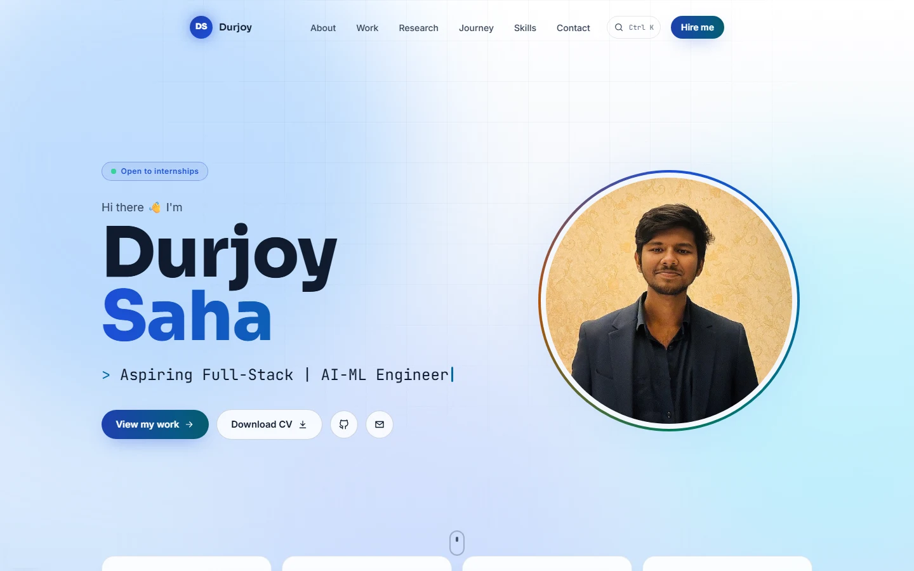

# Durjoy Saha

**Aspiring Full-Stack | AI-ML Engineer** · Final-year CSE at AIUB, Dhaka · CGPA 4.00

[Portfolio](https://durjoysaha21.github.io/portfolio/) ·
[CV](https://durjoysaha21.github.io/portfolio/durjoy-saha-cv.pdf) ·
[GitHub](https://github.com/DURJOYSAHA21) ·
[Email](mailto:durjoy.saha1115@gmail.com)

- **Research:** 6 papers on deepfake and vishing detection, medical imaging and NLP (5 accepted or presented)
- **Projects:** [SkillHub](https://skillhubprototype-frontend.vercel.app/), [JobMatch-BD](https://jobmatch-bd.vercel.app), [Mansion of Lies](https://durjoysaha21.github.io/mansion-of-lies/), [HireHub](https://hirehub.infinityfreeapp.com/) and more
- **Hackathons:** NASA Space Apps 2026, BUP CSE Fest 2026, PSTU IT Carnival 2026
- **Honors:** Dean's List, AIUB

Built with Next.js, Tailwind CSS and TypeScript, hosted on GitHub Pages. Content lives in
`src/content/site.json` and is edited from [/admin](https://durjoysaha21.github.io/portfolio/admin/);
see [PROJECT_GUIDE.md](PROJECT_GUIDE.md) for code changes.
